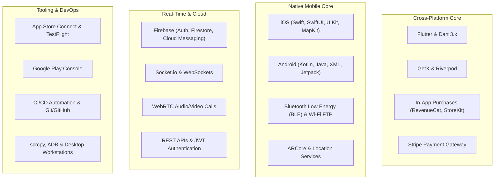
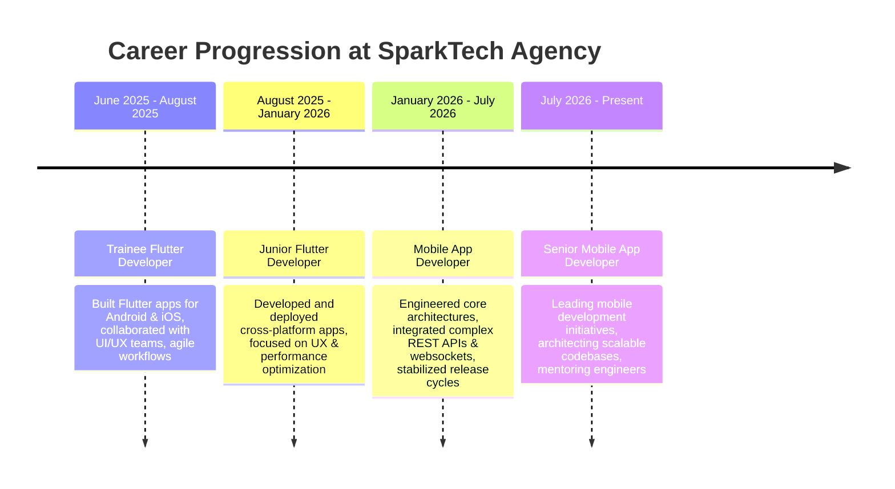

# Rosdeb Koch — Portfolio & Projects Comprehensive Documentation

A complete architectural, engineering, and product dossier covering all 19 projects, developer tools, technical capabilities, industrial experience, and design specifications powering the portfolio website of **Rosdeb Koch**.

---

## 1. Candidate Executive Summary

| Attribute | Details |
| :--- | :--- |
| **Full Name** | **Rosdeb Koch** |
| **Professional Title** | **Senior Mobile & Cross-Platform Software Engineer** |
| **Core Specialization** | Flutter, iOS (Swift / SwiftUI), Android (Kotlin / Java), Developer Tooling, Next.js |
| **Direct Contact** | [rosdevkoch@gmail.com](mailto:rosdevkoch@gmail.com) |
| **GitHub** | [github.com/Rosdeb](https://github.com/Rosdeb) |
| **LinkedIn** | [linkedin.com/in/rosdev-koch-260005324/](https://www.linkedin.com/in/rosdev-koch-260005324/) |
| **Twitter / X** | [x.com](https://x.com) |
| **Curriculum Vitae** | Downloadable PDF ([rosdeb--cv.pdf](file:///Users/rosdebkoch/All_Project/Pilach-Org/public/rosdeb--cv.pdf)) |
| **Experience Metric** | **1.5+ Years** professional production delivery |
| **Shipped Products** | **19+ Projects** & developer workstations |
| **Store Presence** | **10+ Live Apps** on Apple App Store & Google Play Store |
| **Current Status** | 🟢 Available for select mobile & full-stack opportunities & contracts |

---

## 2. Technical Stack & Capability Matrix

### Capability Breakdown

1. **Cross-Platform Delivery:**
   - **Flutter & Dart 3.x:** Declarative reactive UI, custom painters, render box manipulation, platform channels.
   - **State Architecture:** GetX reactive state management, Riverpod, dependency injection, service containers.
   - **Monetization:** Stripe Mobile SDK, RevenueCat, native Google Play Billing & Apple StoreKit subscriptions.

2. **Native Mobile Engineering:**
   - **Apple Platforms:** Swift, SwiftUI, UIKit, MapKit, CloudKit, push notifications (APNs), Apple Sign-In.
   - **Android Ecosystem:** Kotlin, Java, Android Architecture Components, Jetpack, background services, Google Sign-In.
   - **Hardware & IoT:** Bluetooth Low Energy (BLE) peripheral/central communication, Wi-Fi FTP local transfer, smart hardware controls.

3. **Real-Time & Cloud Infrastructure:**
   - **Protocols:** Socket.io bidirectional websockets, WebRTC peer-to-peer audio/video streaming.
   - **Mapping & Geospatial:** Mapbox SDK, Google Maps Platform, live rider/pet GPS tracking, reverse geocoding.
   - **Cloud Services:** Firebase Suite (Firebase Auth, Cloud Firestore, Firebase Cloud Messaging, Realtime Database).

---

## 3. Industrial Experience & Career Timeline

| Timeline | Role | Company | Responsibilities & Key Contributions |
| :--- | :--- | :--- | :--- |
| **July 2026 — Present** | **Senior Mobile App Developer** | **SparkTech Agency** | Leading multi-platform mobile architecture, mentoring developers, enforcing modular clean code, standardizing CI/CD deployments. |
| **January 2026 — July 2026** | **Mobile App Developer** | **SparkTech Agency** | Engineered robust cross-platform applications, integrated mission-critical APIs, handled production performance and memory profiling. |
| **August 2025 — January 2026** | **Junior Flutter Developer** | **SparkTech Agency** | Developed and deployed cross-platform apps, built custom widgets and shimmer loaders, improved retention with responsive layouts. |
| **June 2025 — August 2025** | **Trainee Flutter Developer** | **SparkTech Agency** | Built native bindings for Android and iOS, collaborated on UI designs, and participated in sprint planning and code reviews. |

---

## 4. Comprehensive Catalog of All 19 Projects & Tools

All projects are ordered newest first, with dynamic sequential indices (`01` to `19`), categorized for selective filtering.

### Category Overview
- **All (19):** Complete production portfolio.
- **Flutter (9):** Cross-platform mobile and desktop applications.
- **iOS & Android (10):** Native and store-published mobile applications.
- **Tools (3):** Developer workstations and design utilities.
- **Web (4):** Web platforms, landing pages, and cultural archives.

---

### Project 01: Simulation Tray (Tray)
- **Year:** `2026`
- **Category:** `Tools`, `Flutter` (Desktop)
- **Layout:** Desktop Workstation (16:9 UI)
- **Tags:** `Flutter Desktop`, `macOS`, `Windows`, `scrcpy`, `Developer Tool`, `ADB`
- **Repository / Releases:** [github.com/Rosdeb/Tray/releases/tag/v1.3.4](https://github.com/Rosdeb/Tray/releases/tag/v1.3.4)
- **Description:** Simulation Tray is a lightweight, studio-free Android device & emulator workstation for Windows and macOS. It decouples the entire Android emulation and device workflow from heavy IDEs—slashing RAM consumption from 6GB+ down to ~85MB (<1s startup) with low-latency 60+ FPS scrcpy screen mirroring, real-time filtered Logcat, live CPU/RAM sparklines, wireless ADB, and system tray quick controls.
- **Screenshots:**
  1. `public/tray_screen_1.png` — Device manager & emulator workstation
  2. `public/tray_screen_2.png` — Emulator startup & configuration
  3. `public/tray_screen_3.png` — Ultra-low latency screen mirroring & controls
  4. `public/tray_screen_4.png` — Live logcat, telemetry sparklines & process monitor

---

### Project 02: Givano
- **Year:** `November 2026`
- **Category:** `Flutter`, `iOS & Android`
- **Tags:** `Flutter`, `GetX`, `Socket.io`, `Firebase`, `Real-Time Chat`, `Community`
- **Google Play:** [play.google.com/store/apps/details?id=com.givano.application](https://play.google.com/store/apps/details?id=com.givano.application)
- **Apple App Store:** [apps.apple.com/us/app/givano/id6816919732](https://apps.apple.com/us/app/givano/id6816919732)
- **Description:** Givano is a community-driven peer-to-peer item sharing and giveaway mobile application built with Flutter and GetX. Designed to reduce waste by connecting donors with local recipients via real-time socket chat, interactive discovery feeds, multi-image listing flows, and seamless pickup coordination.
- **Screenshots:**
  1. `public/givano_1.webp` — Explore and discovery feed
  2. `public/givano_2.webp` — Item listing and details
  3. `public/givano_3.webp` — Real-time chat & pickup coordination
  4. `public/givano_4.webp` — User profile & listing management

---

### Project 03: Ayudame Service Provider
- **Year:** `July 2026`
- **Category:** `Flutter`, `iOS & Android`
- **Tags:** `Flutter`, `ARCore`, `Maps API`, `Service Marketplace`
- **Google Play:** [play.google.com/store/apps/details?id=com.lavell.ayudame](https://play.google.com/store/apps/details?id=com.lavell.ayudame)
- **Apple App Store:** [apps.apple.com/us/app/ayudame/id6772288218](https://apps.apple.com/us/app/ayudame/id6772288218)
- **Repository:** [github.com/Rosdeb/Ayudame](https://github.com/Rosdeb/Ayudame)
- **Description:** Ayudame Service Provider helps service professionals manage bookings, connect with customers, track jobs, and grow their business efficiently. Providers can receive service requests, update job status, communicate with customers, and manage earnings from a single app.

---

### Project 04: AppIcon Studio
- **Year:** `2026`
- **Category:** `Tools`, `Web`
- **Layout:** Desktop Web Tool (16:9 UI)
- **Tags:** `Web Tool`, `Next.js`, `App Icons`, `iOS`, `Android`, `Design Utility`
- **Live Web App:** [appicon.site](https://www.appicon.site/)
- **Description:** Free online app icon generator utility for developers and designers. Upload a single 1024x1024 master image to instantly preview, customize, and export all required icon assets and asset catalogs for iOS, Android, macOS, and Windows in one ready-to-use package.
- **Screenshots:**
  1. `public/appicon_preview.png` — Icon generator interface & asset catalog previewer

---

### Project 05: Korot
- **Year:** `2026`
- **Category:** `Web`
- **Tags:** `Web Platform`, `Next.js`, `Linguistics`, `Indigenous Languages`, `Cultural Heritage`
- **Live Platform:** [korot.site](https://korot.site/)
- **Description:** An open digital platform dedicated to preserving and exploring Indigenous languages. Features multi-script support, searchable vocabularies, audio pronunciations, and community-driven collections to safeguard cultural linguistic heritage.
- **Screenshots:**
  1. `public/korot_logo.png` — Korot platform identity and linguistics interface

---

### Project 06: Wuffoos
- **Year:** `May 2026`
- **Category:** `Flutter`, `iOS & Android`
- **Tags:** `Flutter`, `Android`, `iOS`, `Firebase`, `Google Maps`, `Live Tracking`, `Location Sharing`
- **Website:** [wuffoos.com](https://wuffoos.com/)
- **Google Play:** [play.google.com/store/apps/details?id=com.wuffoos.app](https://play.google.com/store/apps/details?id=com.wuffoos.app)
- **Apple App Store:** [apps.apple.com/us/app/wuffoos/id6761444819](https://apps.apple.com/us/app/wuffoos/id6761444819)
- **Description:** Wuffoos helps pet owners find available dog or cat sitters near them, and lets animal lovers register as sitters to earn extra income flexibly. Includes live tracking and location sharing so owners can follow along while their pet is in care.
- **Screenshots:**
  - 7 screens (`petcare_1.jpeg` through `petcare_8.jpeg`) covering onboarding, maps, and tracking.

---

### Project 07: Titra
- **Year:** `March 2026`
- **Category:** `Flutter`
- **Tags:** `Flutter`, `WebRTC`, `Audio/Video Call`, `Real-time Communication`
- **Description:** Titra is a mobile app for real-time WebRTC audio and video calls. Each user gets a unique 10-digit number, and calls connect end-to-end using that number with minimal latency.

---

### Project 08: TradeLMT
- **Year:** `2025`
- **Category:** `Web`
- **Layout:** Desktop Web Portal
- **Tags:** `Next.js`, `Trading Platform`, `Financial Tech`, `Landing Page`, `Dark Mode`
- **Live Web Portal:** [trading-platform-landing-page-rose.vercel.app](https://trading-platform-landing-page-rose.vercel.app/)
- **Repository:** [github.com/rosdeb/TradeLMT](https://github.com/rosdeb/TradeLMT)
- **Description:** High-performance trading platform web portal for futures and derivatives trading. Features zero account minimums, broker connectivity, live market telemetry previews, responsive dark-mode layouts, and interactive platform onboarding.
- **Screenshots:**
  1. `public/tradelmt_hero.webp` — TradeLMT platform portal interface

---

### Project 09: SafeRadar
- **Year:** `2025`
- **Category:** `iOS & Android`
- **Tags:** `iOS`, `Android`, `Real-time`, `Safety`, `Emergency Network`
- **Website:** [saferadar.net](https://www.saferadar.net/)
- **Apple App Store:** [apps.apple.com/us/app/saferadar/id6758638644](https://apps.apple.com/us/app/saferadar/id6758638644)
- **Google Play:** [play.google.com/store/apps/details?id=com.saferadar.net](https://play.google.com/store/apps/details?id=com.saferadar.net)
- **Description:** SafeRadar is a real-time safety assistance app that connects people who need help with compassionate volunteers ready to provide support, putting an immediate safety network at users' fingertips.
- **Screenshots:**
  - 6 screens (`saferadar-splash.png` through `saferadar-map.png`).

---

### Project 10: Koko App
- **Year:** `2025`
- **Category:** `iOS & Android`
- **Tags:** `Android`, `iOS`, `IoT`, `BLE`, `Wi-Fi FTP`, `Device Control`
- **Website:** [kokocreates.com](https://kokocreates.com/)
- **Apple App Store:** [apps.apple.com/app/koko-creates/id6759178175](https://apps.apple.com/app/koko-creates/id6759178175)
- **Description:** Koko App is a mobile device-control project for managing connected hardware from one place, including light control, volume adjustment, alarms, screen lock, sleep timers, Wi-Fi FTP file-system transfer, classic media playback, and BLE-based device communication.
- **Screenshots:**
  - 9 screens (`koko_1.jpeg` through `device_connect_screen.jpeg`).

---

### Project 11: Parkelo
- **Year:** `2025`
- **Category:** `Flutter`, `iOS & Android`
- **Tags:** `Parking Management`, `Flutter`, `Real-Time`, `IoT`, `Location Services`
- **Repository:** [github.com/Rosdeb/Parkelo](https://github.com/Rosdeb/Parkelo)
- **Description:** Smart parking management and booking system designed to simplify parking space discovery, real-time slot reservation, ticketless check-in, and automated parking fee management for drivers and parking operators.

---

### Project 12: Shopreal
- **Year:** `2025`
- **Category:** `Tools`
- **Tags:** `AI`, `Product Validation`, `E-commerce`, `Dropshipping`, `Developer Tool`
- **Description:** Shopreal helps sellers validate products from an image or product link, checking whether an item looks trustworthy, has strong market potential, and is a good fit for dropshipping before they spend time or money promoting it.
- **Screenshots:**
  - 4 screens (`home_screen.jpeg`, `product_details.jpeg`, `card.jpeg`, `profile.jpeg`).

---

### Project 13: Koukoutsa
- **Year:** `July 2025`
- **Category:** `Flutter`, `iOS & Android`
- **Tags:** `Flutter`, `SMS System`, `Classification`, `Attendance`
- **Google Play:** [play.google.com/store/apps/details?id=com.niki.koukoutsa](https://play.google.com/store/apps/details?id=com.niki.koukoutsa)
- **Description:** Koukoutsa is a smart student attendance management app for schools, coaching centers, and training institutes. It simplifies tracking presence, absence, and leave, and automatically sends a message or alert to a parent or registered contact when a student is not present.
- **Screenshots:**
  - 7 screens (`Onboarding.png` through `My Profile.png`).

---

### Project 14: Wellbyn
- **Year:** `June 2025`
- **Category:** `Flutter`
- **Tags:** `Flutter`, `WebSocket`, `Node.js`, `Firebase`, `Real-time`, `Healthcare`
- **Website:** [wellbyn.ai](https://www.wellbyn.ai/)
- **Description:** Healthcare management platform that enables patients to book appointments, receive medication reminders, securely store medical records, manage insurance, and automatically reschedule appointments while helping doctors streamline patient care.

---

### Project 15: Koch Heritage
- **Year:** `2025`
- **Category:** `Web`
- **Tags:** `Web Development`, `Next.js`, `Cultural Heritage`, `One-Page`, `Responsive`
- **Live Website:** [koch-people-one-page-website.vercel.app](https://koch-people-one-page-website.vercel.app/)
- **Repository:** [github.com/Rosdeb/Tintekiya_Koch_Website](https://github.com/Rosdeb/Tintekiya_Koch_Website)
- **Description:** An editorial one-page cultural website dedicated to the history, indigenous traditions, art, and heritage of the Koch people. Built with fluid animations, responsive typography, and archival storytelling.

---

### Project 16: LEG!ER GLOBAL NEWS
- **Year:** `2024`
- **Category:** `Flutter`
- **Tags:** `Flutter`, `Live News`, `Multilingual`
- **Website:** [legiergroup.com/en](https://legiergroup.com/en/)
- **Google Play:** [play.google.com/store/apps/details?id=com.pagedrop.lagier](https://play.google.com/store/apps/details?id=com.pagedrop.lagier&hl=en)
- **Apple App Store:** [apps.apple.com/au/app/legier-global-news/id6756674261](https://apps.apple.com/au/app/legier-global-news/id6756674261)
- **Description:** LEG!ER GLOBAL NEWS brings together 115 newspapers from around the world, including 72 live online publications, with breaking headlines, video reports, multilingual content, and article listening in one global news experience.
- **Screenshots:**
  - 5 screens (`legier-home.webp` through `legier-more.png`).

---

### Project 17: Riptide Rentals
- **Year:** `2024`
- **Category:** `iOS & Android`
- **Tags:** `SwiftUI`, `iOS`, `Apple Build`, `Navigation`
- **Website:** [riptiderentals.com](https://www.riptiderentals.com/)
- **Apple App Store:** [apps.apple.com/au/app/riptide-rentals/id6757623532](https://apps.apple.com/au/app/riptide-rentals/id6757623532)
- **Description:** Completely free SwiftUI app for Riptide Jet Ski Rentals in southwest Florida, built to guide riders with easy navigation to popular spots, landmarks, wildlife areas, islands, and sandbars right from the water.
- **Screenshots:**
  - 3 screens (`riptide-rentals-map.webp`, `riptide-rentals-points.webp`, `0x0ss.png`).

---

### Project 18: Rentalvate
- **Year:** `2022`
- **Category:** `iOS & Android`
- **Tags:** `Swift`, `CloudKit`, `iOS SDK`, `Education`
- **Description:** Interactive iOS learning platform with course management, guided lessons, and progress tracking built with Swift and CloudKit.

---

### Project 19: The Mom App
- **Year:** `2022`
- **Category:** `iOS & Android`
- **Tags:** `Kotlin`, `Maps SDK`, `Django`, `Family Organization`
- **Website:** [themom.app](https://themom.app/)
- **Google Play:** [play.google.com/store/apps/details?id=com.momapp.family](https://play.google.com/store/apps/details?id=com.momapp.family)
- **Apple App Store:** [apps.apple.com/app/id6756739178](https://apps.apple.com/app/id6756739178)
- **Description:** The Mom App helps busy moms reclaim time, reduce stress, and stay organized from one AI-powered hub. Whether you're juggling work, kids, calendars, meals, chores, reminders, passwords, or grocery lists, it helps you organize and share the load.

---

## 5. Portfolio Website Architecture & UI System

### Tech Stack
- **Framework:** Next.js `16.0.10` (App Router)
- **Runtime & Compiler:** React `19.2.0`, Turbopack
- **Language:** TypeScript 5.9
- **Styling:** Tailwind CSS 4, CSS variables design tokens, custom `@keyframes`
- **Asset Optimization:** Next.js `next/image` with WebP and responsive sizes
- **Backend Email:** Server-rendered Next.js Route Handler (`/api/contact`) with `nodemailer`

### Key UI Innovations & Engineering Solutions

1. **Jitter-Free Segmented Control Tab Bar:**
   - Single-line flex container with zero-dependency CSS hardware acceleration (`transform: translateX(...)`).
   - Smooth `cubic-bezier(0.2, 0.9, 0.3, 1)` easing.
   - Fixed text weights to eliminate browser font reflow jitter on active tab changes.
   - Conditional scroll offset calculation: avoids horizontal page shakes on wide screens.

2. **Smooth Staggered Project List:**
   - Minimum container height (`min-height: 440px`) to prevent page height collapse when toggling between large categories ("All" with 19 items) and small ones ("Tools" with 3 items).
   - `@keyframes projectRowFadeIn` micro-delays (`18ms` per item capped at `160ms`) for a fluid Linear/Apple-grade entrance.

3. **Dynamic Responsive Media Lightbox:**
   - Dual-layout responsive support (`desktop` 16:9 for tools/web and `mobile` 9:19.5 for phones).
   - Keyboard listeners (<kbd>Esc</kbd> to close, <kbd>←</kbd> and <kbd>→</kbd> to cycle).
   - Fullscreen modal overlay with body scroll-locking.

4. **Brand Consistency Across Sections:**
   - Custom `<RKLogo />` component.
   - Branded vector SVG pills for GitHub, LinkedIn, Twitter/X, and Email in both the Contact and Footer components.
